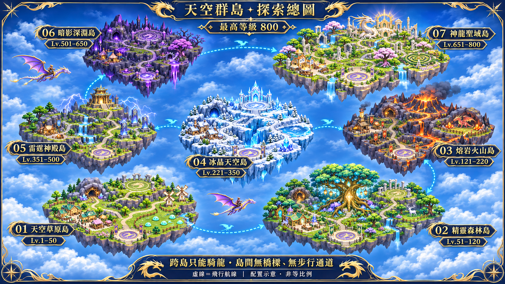

# 龍之覺醒：天空群島 · DragonStory

動漫戰鬥風格的 Roblox 騎龍冒險原型。玩家在彼此分離的七座天空島嶼間飛行，打怪升級、收集裝備，並隨玩家等級解鎖更威風的龍形態。**目前遊戲版本為 v9，等級上限 Lv.800。**

本儲存庫收錄目前完成的 Luau 客戶端、伺服器、ModuleScript、模型製作資料、設計圖、掉落表、測試及敘事劇本；完整 Studio 遊戲檔和歷代交付版本放在 [Releases](https://github.com/lionelchenlr-del/DragonStory/releases/tag/v9-2026-11-16)。目前未發布 Roblox 線上體驗。



> 圖片為概念設計。遊戲以原生曲面幾何、材質和分層細節呈現；尚未完全還原插畫中的手繪紋理。模型預覽是另行渲染，並非 Studio 實機截圖。

## 先下載哪個？

| 目的 | 下載／入口 |
|---|---|
| 直接開啟遊戲 | [DragonAwakening-Atelier-v9.zip](https://github.com/lionelchenlr-del/DragonStory/releases/download/v9-2026-11-16/DragonAwakening-Atelier-v9.zip) |
| 編輯遊戲劇本 | [Word 劇本 v1.0](story/龍之覺醒天空群島_遊戲敘事劇本_v1.0.docx) · [直接閱讀文字版](story/遊戲敘事劇本_v1.0.md) |
| 看怪物、裝備及原圖 | [美術與地圖導覽](docs/美術與地圖導覽.md) |
| 查怪物在哪裡、掉什麼、機率多少 | [28 種怪物與 126 個生成座標](game/docs/怪物所在地與掉落表.md) |
| 看全部歷史檔 | [交付檔案索引與校驗碼](archive/README.md) |

### 用 Roblox Studio 開啟

1. 下載上方 **v9 ZIP**，完整解壓縮到本機資料夾。
2. 開啟 Roblox Studio，使用「Open from File／從檔案開啟」選擇 `DragonAwakening-Atelier-v9/DragonAwakening-Atelier-v9.rbxl`。
3. 按 **Play**。先在天空草原島體驗背包、商店、戰鬥和飛行；按 **Stop** 結束。
4. 解壓縮後的 `專案預覽.html` 可在本機瀏覽器開啟，比較全部 58 個怪物／裝備的 v8、v9 外觀。GitHub 檔案頁不會直接執行此 HTML。

**只想玩不必安裝 Rojo、Python 或 Luau CLI。** 模型與腳本已放入 `.rbxl`。開啟完整檔案可能需要等待大型場景載入。Studio 預設不保存測試進度；正式 DataStore 另見 [上線與存檔](game/docs/上線與存檔.md)。

## 操作方式

| 按鍵 | 功能 |
|---|---|
| F | 騎龍；接近地面時下龍 |
| W / A / S / D | 移動／水平飛行 |
| Space／空白鍵 | 騎龍上升 |
| Q | 騎龍下降 |
| Shift | 飛行加速 |
| E | 地面攻擊 |
| R | 與附近 NPC／互動點互動 |
| B | 背包 |
| M | 地圖 |

騎龍負責跨島移動，落地後下龍戰鬥。島嶼間保留天空間隙，沒有可直接步行跨島的橋。現有飛行使用伺服器移動判定及共同平滑姿態，騎手、龍與鏡頭使用一致的顯示資料；修正細節見 [飛行修正與驗證](game/docs/飛行修正與驗證.md)。

## 目前可用內容

| 系統 | v9 內容 |
|---|---|
| 世界 | 七座分離天空島嶼、聚落、洞窟、試煉場、祕境與遺跡互動點 |
| 角色成長 | Lv.1–800；四種龍形態依玩家等級解鎖 |
| 戰鬥與怪物 | 28 種怪物、126 個分散生成點、巡邏／追擊／返回與掉寶 |
| 裝備 | 30 件：2 件起始裝備、7 套各 4 件；穿戴與套裝加成 |
| 商店 | 20 個金幣商品，前五島各四件；後兩島套裝靠掉落取得 |
| 介面 | 背包、套裝圖鑑、怪物圖鑑、金幣商店、龍、地圖六個分頁 |
| 美術 | 全部 28 種怪物與 30 件裝備再次細化；保留四龍、環境模型及 17 張設計原圖 |
| 儲存 | 正式伺服器存檔、租約與資料格式遷移程式；需在自己的測試體驗驗證 |
| 劇本 | 28 頁 Word，25 場敘事、28 個任務規劃、角色／世界／怪物／裝備與擴寫模板 |

### 七島探索順序

| 島嶼 | 玩家等級範圍 | 套裝 |
|---|---|---|
| 天空草原島 | 1–50 | 天空巡衛 |
| 精靈森林島 | 51–120 | 森靈誓約 |
| 熔岩火山島 | 121–220 | 烈焰龍王 |
| 冰晶天空島 | 221–350 | 冰霜守護者 |
| 雷霆神殿島 | 351–500 | 雷霆裁決 |
| 暗影深淵島 | 501–650 | 虛空龍神 |
| 神龍聖域島 | 651–800 | 神龍聖裁 |

每島有 8 個一般怪、5 個菁英怪、4 個洞窟怪與 1 個首領生成點；洞窟怪分散在三個房間。地表初始生成間距至少約 90 studs，洞內約 65 studs。巡邏後距離會變動；同一玩家最多被兩隻非首領怪追擊，首領另計。完整地標、空隙與座標見 [七島地圖](game/docs/七島地圖與地點座標.md) 和 [分布驗收](game/docs/v8怪物分布與驗收.md)。

### 龍的成長

| 玩家等級 | 可用形態 |
|---|---|
| Lv.1 | 晴空幼龍 |
| Lv.151 | 蒼嵐戰龍 |
| Lv.351 | 曜金聖龍 |
| Lv.651 | 星穹龍皇 |

目前以**玩家等級**判定解鎖，尚未加入寵物獨立經驗值、孵蛋或繁殖。龍的上升、下降與飛行移動已實作；空中吐息傷害尚未實作。

### 掉寶機率與套裝

每次擊殺最多抽出 **一件裝備**，也可能沒有裝備；以下各欄是互斥結果，並非每件各自獨立抽獎。同島四種怪物掉同島套裝的四個部位。

| 類別 | 武器 | 頭盔 | 胸甲 | 戰靴 | 無裝備 |
|---|---:|---:|---:|---:|---:|
| 一般怪 | 2% | 4% | 4% | 5% | 85% |
| 菁英怪 | 5% | 8% | 8% | 9% | 70% |
| 洞窟怪 | 8% | 12% | 12% | 13% | 55% |
| 島嶼首領 | 15% | 25% | 35% | 25% | 0% |

天空見習劍與旅人護甲為起始贈送。兩件套加攻擊 8%；四件套再加 HP 12% 及該套固定防禦（依島序為 7／10／13／16／19／22／25）。目前沒有三件套額外效果，也沒有穿齊後解鎖主動技能。每隻怪物名稱、等級、地點、物品名稱與機率均列在 [完整掉落表](game/docs/怪物所在地與掉落表.md)。

## 專案結構與 Explorer

```text
DragonStory/
├── README.md                 # 此入口
├── game/                     # v9 可編輯遊戲原始碼與製作資料
│   ├── default.project.json  # Rojo → Roblox Explorer 對應
│   ├── src/
│   │   ├── ReplicatedStorage/DragonShared/
│   │   ├── ServerScriptService/DragonServer/
│   │   ├── StarterGui/DragonUI/
│   │   └── Workspace/
│   ├── art/                  # 17 張原圖、外觀／環境／場景配方、分布資料
│   ├── design-reference/     # 地圖與掉落設計資料
│   ├── previews/             # v8／v9 模型渲染圖
│   ├── tools/                # 造型、Studio 烘焙、渲染與重建工具
│   ├── tests/                # Luau 規則及移動服務測試
│   └── docs/                 # 遊戲內部設計與歷次驗收文件
├── story/                    # Word 劇本及可直接閱讀的 Markdown 版
├── design/early-concepts/    # 商店、龍進化等早期設計稿
├── docs/                     # 此儲存庫的導讀與維護方式
├── archive/                  # 所有版本下載索引與 SHA-256
└── tools/restore_assets.py   # 還原三個大型原生檔
```

`game/src` 與 Explorer 的放置關係、每個核心模組用途，見 [Explorer 與程式說明](game/docs/Explorer與程式說明.md)。`DragonRemotes`、怪物狀態和互動點由伺服器啟動時建立。

## 下載原始碼後如何重建

一般 Git checkout 或 GitHub 的 **Download ZIP** 包含原始碼，但不包含三個超過 100 MiB 的原生檔案；完整遊戲下載請用 Releases 的 v9 ZIP。這些大型檔是 `.rbxl`、`BakedArt.rbxmx`、`SkyIslands.rbxmx`，均有校驗碼。

在儲存庫根目錄執行（Python 3.10+，只用標準函式庫）：

```sh
python3 tools/restore_assets.py --download
python3 game/tools/build_place.py
```

第一行下載並驗證固定版本 v9 ZIP，只還原三個大型檔；第二行需要自行安裝 [Rojo](https://rojo.space/docs/v7/getting-started/installation/)，將目前原始碼重建為 `game/DragonAwakening-Atelier-v9.rbxl`。若已下載 v9 ZIP，可離線還原：

```sh
python3 tools/restore_assets.py --archive /完整路徑/DragonAwakening-Atelier-v9.zip
```

還原後若只想玩，可直接開啟 `game/DragonAwakening-Atelier-v9.rbxl`，不用重建。**修改腳本後必須重新 build，才能讓變更進入 `.rbxl`。** Rojo live sync 請先閱讀 [開發與重建](docs/開發與重建.md) 的大型場景注意事項。

## 伺服器驗證與存檔

客戶端提交購買、裝備、攻擊或移動的意圖。價格、金幣、持有權、傷害、掉落結果與飛行位置由伺服器判定。

- `GameServer`：協調 Remote 請求與服務。
- `RequestGuard`：檢查輸入格式與請求頻率。
- `Domain`、`Settings`、`CombatRules`：處理經濟、等級、裝備、戰鬥和掉落。
- `TravelService`、`TravelRules`：驗證移動、碰撞、飛行、落地及島嶼門檻。
- `ProfileStore`：使用 UpdateAsync、租約與資料遷移保護存檔；無法取得有效資料時不以新手資料覆蓋。

請先用自己的獨立測試體驗驗證 DataStore、多人與裝置效能，再安排正式發布。Studio 預設 `StudioPersistence=false`，Stop 後重設本地測試進度。完整設定與資料庫名稱見 [上線與存檔](game/docs/上線與存檔.md)。

## 測試與目前限制

安裝官方 [Luau CLI](https://github.com/luau-lang/luau) 後：

```sh
python3 game/tests/run_checks.py
```

交付 v9 已保留 [VALIDATION.json](game/VALIDATION.json) 與 [驗收說明](game/docs/v9細化與驗收.md)：653 個 Luau 檔案曾通過編譯，規則／幾何測試及 155 個 TravelService 引擎替身檢查通過；單客戶端 Studio 整合驗證涵蓋購買、裝備、拒絕未持有物品、擊殺獎勵、上升下降與鏡頭一致性。大量斷言多為幾何檢查，不能代表同等數量的遊玩情境。

尚未完成多人壓力測試、手機效能與完整觸控操作驗收、正式 DataStore 實測及 Roblox 線上發布。模型精細度與插畫仍有差距。Word 中新增對話、過場、角色關係、任務旗標屬於後續製作提案，**不代表全部已寫入遊戲**。完整對照見 [進度與版本](docs/進度與版本.md)。

## 接下來擴充劇本

先讀 [遊戲敘事劇本](story/遊戲敘事劇本_v1.0.md)，再用 [擴寫指南與場次模板](docs/劇本擴寫指南.md) 延續第一部。現有第一部以 Lv.800「遠古神龍」試煉收束；「暗黑滅世龍」為後續主線伏筆，目前不是已實作首領。新增島嶼或裝備時，需同步劇本、Catalog／WorldData、掉落與測試，不直接覆寫目前 Lv.800 基準。

## 版本、檔案與授權

最新版請用 **v9**；舊版 ZIP 是進度封存，可能含已改版的數值、模型和操作。所有交付檔案的大小、下載連結及 SHA-256 見 [archive](archive/README.md)。最新遊戲檔、來源 ZIP 與 Word 均保留原始內容；儲存庫另補充導讀與大型資產還原工具。

尚未選定開源授權。公開可下載不表示已授予任意再散布或商用權；素材來源與待確認事項見 [素材與授權](docs/素材與授權.md)。本專案不是 Roblox 官方作品，也未複製參考遊戲的程式或模型。
