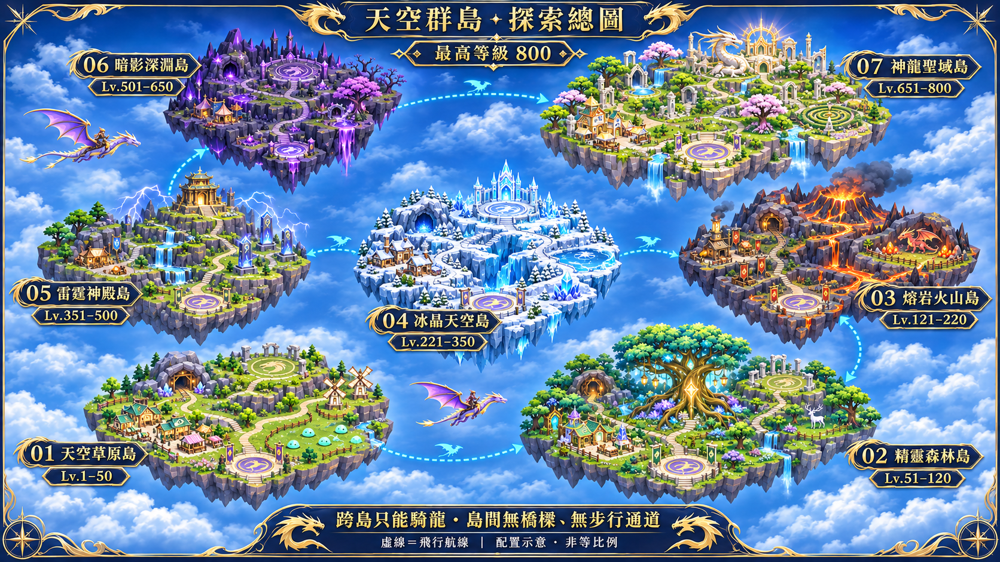
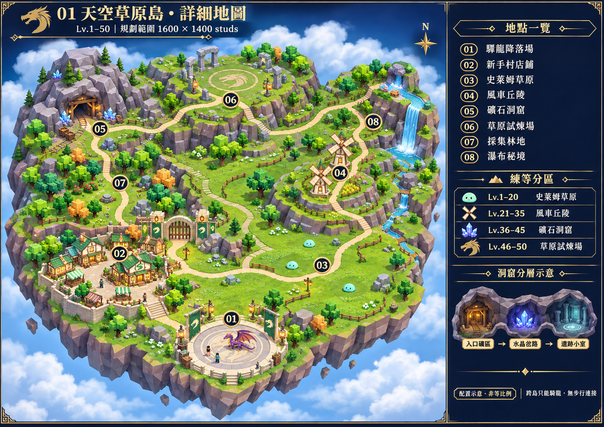
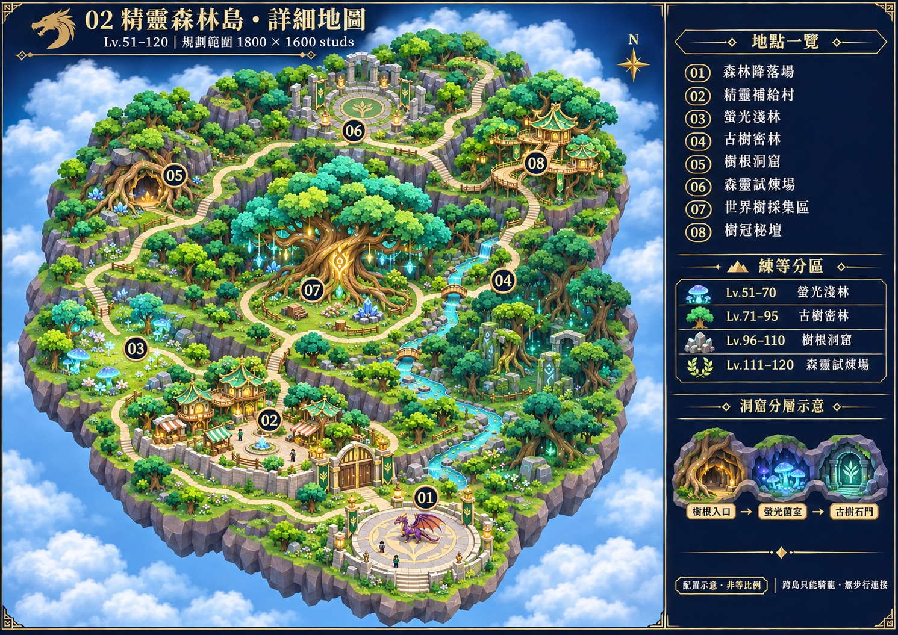
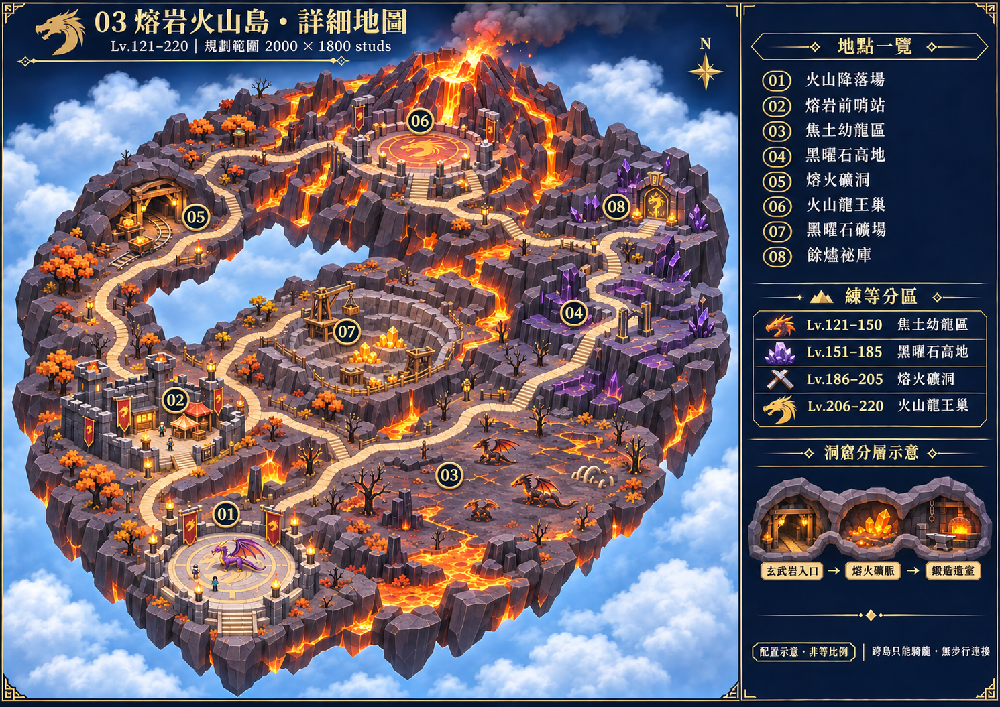
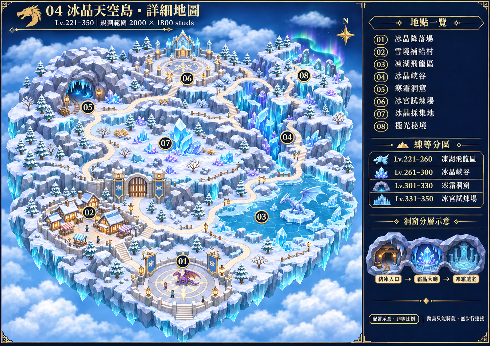
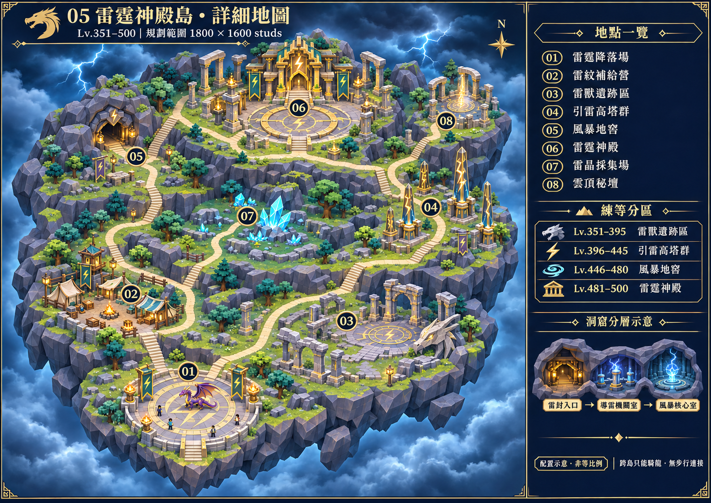
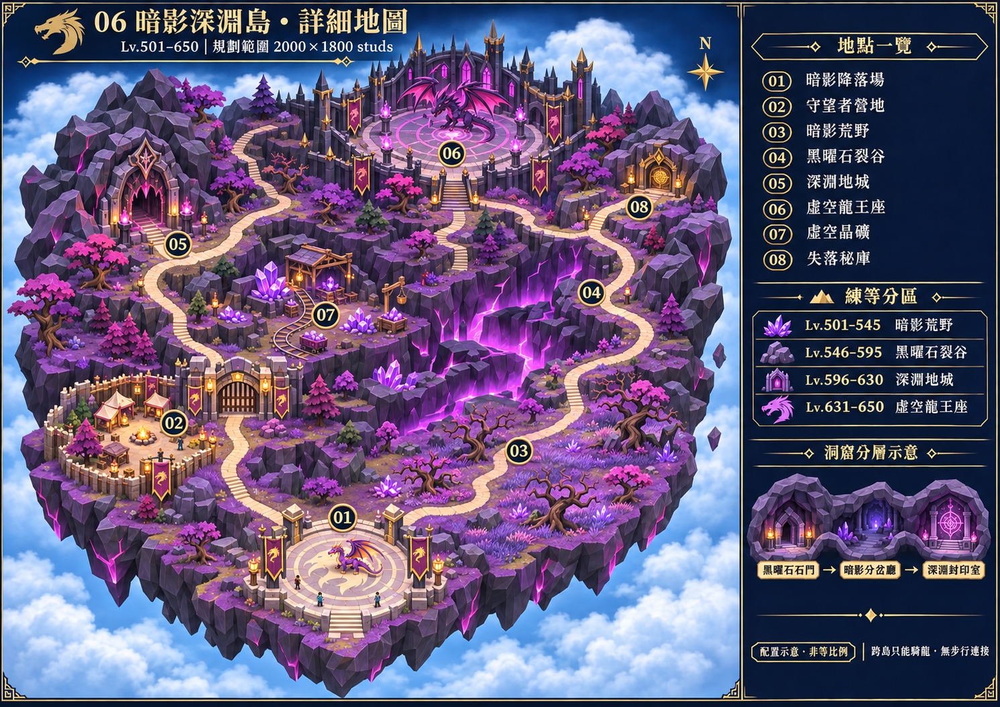
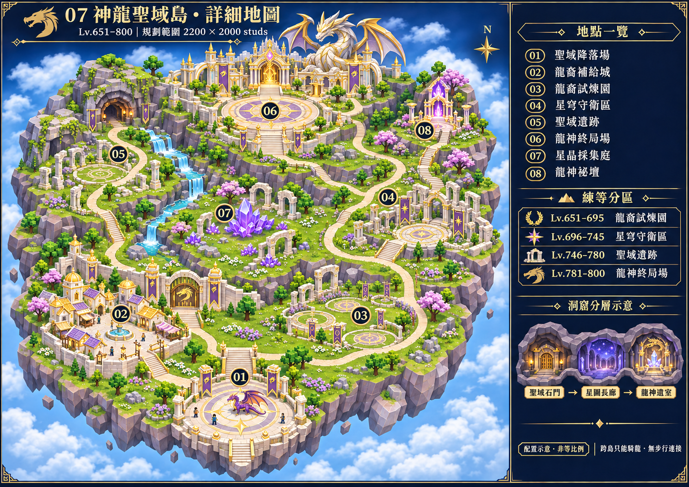

# 七島地圖與地點座標

座標單位是 Roblox stud。各島的建造外框保留至少 1400 格間隙；本次場景實體可碰撞物件的水平包圍盒最短間隔為 1540 格。島內有路，島與島之間沒有橋。地圖標記只顯示方向與距離，不會傳送玩家。

| 島嶼 | ID | 等級 | 中心 X,Y,Z | 大小 X×Z |
|---|---|---|---|---|
| 天空草原島 | `grassland` | 1–50 | -3400, 0, 3200 | 1600×1400 |
| 精靈森林島 | `elven_forest` | 51–120 | 0, 150, 3200 | 1800×1600 |
| 熔岩火山島 | `volcano` | 121–220 | 3400, 300, 0 | 2000×1800 |
| 冰晶天空島 | `ice_crystal` | 221–350 | 0, 500, 0 | 2000×1800 |
| 雷霆神殿島 | `thunder_temple` | 351–500 | -3400, 650, 0 | 1800×1600 |
| 暗影深淵島 | `shadow_abyss` | 501–650 | -3400, 850, -3300 | 2000×1800 |
| 神龍聖域島 | `dragon_sanctuary` | 651–800 | 600, 1100, -3500 | 2200×2000 |

## 天空草原島

| 編號 | 地點 | 世界 X,Y,Z |
|---:|---|---|
| 01 | 驛龍降落場 | -3400, 0, 3676 |
| 02 | 新手村店鋪 | -3784, 0, 3466 |
| 03 | 史萊姆草原 | -3080, 0, 3480 |
| 04 | 風車丘陵 | -3016, 50, 3102 |
| 05 | 礦石洞窟 | -3848, 45, 2920 |
| 06 | 草原試煉場 | -3400, 90, 2780 |
| 07 | 採集林地 | -3768, 20, 3158 |
| 08 | 瀑布祕境 | -2872, 50, 2864 |

## 精靈森林島

| 編號 | 地點 | 世界 X,Y,Z |
|---:|---|---|
| 01 | 森林降落場 | 306, 150, 3744 |
| 02 | 精靈補給村 | -126, 170, 3520 |
| 03 | 螢光淺林 | -504, 170, 3376 |
| 04 | 古樹密林 | 378, 215, 3088 |
| 05 | 樹根洞窟 | -450, 195, 2848 |
| 06 | 森靈試煉場 | -18, 250, 2672 |
| 07 | 世界樹採集區 | -72, 195, 3104 |
| 08 | 樹冠祕壇 | 540, 250, 2768 |

## 熔岩火山島

| 編號 | 地點 | 世界 X,Y,Z |
|---:|---|---|
| 01 | 火山降落場 | 2960, 300, 594 |
| 02 | 熔岩前哨站 | 2900, 325, 234 |
| 03 | 焦土幼龍區 | 3640, 320, 396 |
| 04 | 黑曜石高地 | 3900, 400, -72 |
| 05 | 熔火礦洞 | 2880, 380, -360 |
| 06 | 火山龍王巢 | 3400, 470, -576 |
| 07 | 黑曜石礦場 | 3300, 365, -72 |
| 08 | 餘燼祕庫 | 4060, 410, -432 |

## 冰晶天空島

| 編號 | 地點 | 世界 X,Y,Z |
|---:|---|---|
| 01 | 冰晶降落場 | 0, 500, 630 |
| 02 | 雪境補給村 | -520, 515, 306 |
| 03 | 凍湖飛龍區 | 380, 500, 342 |
| 04 | 冰晶峽谷 | 520, 590, -144 |
| 05 | 寒霜洞窟 | -520, 570, -342 |
| 06 | 冰宮試煉場 | 20, 650, -594 |
| 07 | 冰晶採集地 | -140, 560, -126 |
| 08 | 極光祕境 | 660, 620, -504 |

## 雷霆神殿島

| 編號 | 地點 | 世界 X,Y,Z |
|---:|---|---|
| 01 | 雷霆降落場 | -3796, 650, 512 |
| 02 | 雷紋補給營 | -3832, 675, 192 |
| 03 | 雷獸遺跡區 | -3130, 675, 320 |
| 04 | 引雷高塔群 | -2914, 750, -112 |
| 05 | 風暴地窖 | -3886, 715, -336 |
| 06 | 雷霆神殿 | -3382, 830, -528 |
| 07 | 雷晶採集場 | -3472, 720, -80 |
| 08 | 雲頂祕壇 | -2824, 790, -432 |

## 暗影深淵島

| 編號 | 地點 | 世界 X,Y,Z |
|---:|---|---|
| 01 | 暗影降落場 | -3780, 850, -2706 |
| 02 | 守望者營地 | -3920, 880, -3048 |
| 03 | 暗影荒野 | -3100, 870, -2958 |
| 04 | 黑曜石裂谷 | -2900, 950, -3408 |
| 05 | 深淵地城 | -3940, 925, -3678 |
| 06 | 虛空龍王座 | -3380, 1030, -3912 |
| 07 | 虛空晶礦 | -3500, 930, -3408 |
| 08 | 失落祕庫 | -2740, 970, -3750 |

## 神龍聖域島

| 編號 | 地點 | 世界 X,Y,Z |
|---:|---|---|
| 01 | 聖域降落場 | 600, 1100, -2800 |
| 02 | 龍裔補給城 | 28, 1130, -3120 |
| 03 | 龍裔試煉園 | 1040, 1140, -3120 |
| 04 | 星穹守衛區 | 1172, 1220, -3640 |
| 05 | 聖域遺跡 | 6, 1190, -3900 |
| 06 | 龍神終局場 | 600, 1320, -4180 |
| 07 | 星晶採集庭 | 468, 1190, -3600 |
| 08 | 龍神祕壇 | 1348, 1260, -4020 |

## 地下區

05 為地表入口，按 R 進入真正的地下空間，入口室位於同一 X/Z、島中心 Y−300。往前依序是怪物室與遺物室；有地板、牆壁、門洞與出口，不是只有文字標記。洞內怪物位置與圖鑑的入口地圖座標配對。
